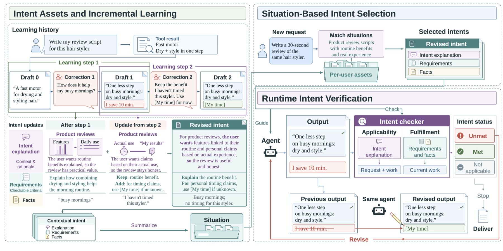
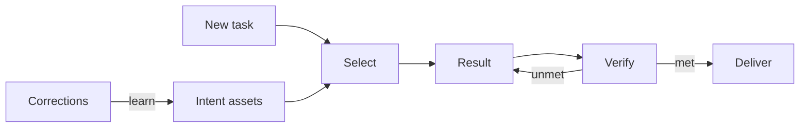

# LiveAsset

[简体中文](README.zh-CN.md) · **English**

**User task requirements often become clear only through multi-turn interaction with the agent. Users can articulate where a delivered result falls short, but frequently cannot specify the desired outcome until a result finally satisfies them. LiveAsset accumulates the expectations revealed by successive corrections into reusable intent assets, mirroring human multi-turn interaction to guide agent behaviour until it matches the user's expectations.**

*Corrective interaction is not an edge case: in the report's analysis of [SWE-chat coding dialogues](https://arxiv.org/abs/2604.20779), 135 of 331 corrective or clarifying messages (40.8%) identify what the agent did wrong without specifying the desired result.*

[](https://arxiv.org/abs/2611.11560) [](https://www.python.org/downloads/) [](https://github.com/landian60/LiveAsset/releases)

*LiveAsset: Learning Intent Assets from Corrective Interactions for Agent Runtime Control*  
Guanming Liu et al. · arXiv:2611.11560 · 2026

### Example: two corrections

A user asks the agent for a 30-second review script for a hair styler that dries and styles in one step. The initial draft states only a product specification: "A fast motor for drying and styling hair." The user provides no requirements document, only two corrective messages (Figure 3, shown below).

| Round | User correction | Revised result |
| --- | --- | --- |
| 1 | "How does it help my busy mornings?" — not a question: *the script should state the benefit for a rushed morning* | "One less step on busy mornings: dry and style. I save 10 min." |
| 2 | "Keep the benefit, but I haven't timed it. Don't invent my results. Use [My time] for now." | "One less step on busy mornings: dry and style. I save [My time]." |

Neither correction states a reusable requirement. The first is phrased as a question but functions as a request to include the morning benefit in the script. The first revision adds that benefit — and, unprompted, the timing claim "I save 10 min.", which the user never supplied; the second correction targets exactly this claim. Comparing the original and revised results around each step reveals two requirements: relate the product benefit to the user's morning routine, and leave unreported personal measurements as placeholders rather than invented values. The added requirement does not replace the first. Together with the situation description, these form the intent asset.

**Later task:** the user requests another 30-second review script for the same product. The draft again states "I save 10 min." → the checker marks it `unmet` and blocks delivery → the same agent revises it to "I save [My time]." → `met`, delivered.

**Learn** from each correction together with the results before and after it → **Select** the situation at the next task entry → **Verify** every requirement against the current result.

The [examples](examples/README.md) run the same three stages offline with scripted model replies, including the five benchmark cases. No API key or network is required.

## News

- **2026-11-08** — Technical report posted on [arXiv](https://arxiv.org/abs/2611.11560) (v1).
- **2026-11** — **v0.1.0 initial public source release**: core library, standalone Codex plugin and hooks, MCP server, offline examples, and anonymized routing fixtures.

## Contents

- [What is LiveAsset?](#what-is-liveasset)
- [Results](#results)
- [How it works](#how-it-works)
- [Quickstart](#quickstart)
- [Use it with an agent](#use-it-with-an-agent)
- [Examples](#examples)
- [Repository layout](#repository-layout)
- [Citation](#citation)
- [Contributing](#contributing)
- [License](#license)

## What is LiveAsset?

LLM agents working across web applications often need multi-turn corrective interaction before their output matches the user's expectations. Users frequently identify a discrepancy in a delivered result without being able to specify the desired outcome, so the expectation has to be inferred from what changed between the original and revised results. LiveAsset is an **intent harness** that turns those corrections into reusable **intent assets** and uses them to control later agent executions.

- **Learn from corrections, not just instructions.** Each correction is interpreted jointly with the agent's original and revised results, so implicit expectations can be recovered from what changed. Assets are updated incrementally while earlier requirements that still apply are preserved.
- **Store context, not just facts.** An asset groups intents into **situations**. Each intent carries an *explanation* (when and why it applies), individually **checkable requirements**, and supporting **facts** with their source quotations. The explanation approximates applicability; the requirements and facts approximate the criterion.
- **Verify before delivery.** At task entry, situation matching selects the relevant intents. Before a reply is delivered, an intent checker judges each requirement and fact as `met`, `unmet`, or `not_applicable`, and sends unmet items back to the same agent for a complete revised result.

The example above is Figure 3 of the report; the [examples](examples/README.md) run the same three stages on smaller assets and on the five benchmark cases. Unlike memory retrieval, stored skills, or rule-based release checks, the learned requirements are tied to a described situation *and* verified against the current result at runtime.

## Results

Numbers below are **reported in the paper** (Table 1, actor model GPT-6 Luna).

| Method | [π-Bench](https://arxiv.org/abs/2605.14678) Sat. | [PERMA](https://arxiv.org/abs/2603.23231) Sat. | [Vita](https://arxiv.org/abs/2605.27141) Sat. | [PAST](https://arxiv.org/abs/2608.04003) All / Far | [SkillEvol](https://arxiv.org/abs/2605.24117) All |
| --- | ---: | ---: | ---: | ---: | ---: |
| Raw history | 0.801 | 0.881 | 0.789 | 0.933 / 0.910 | 0.857 |
| Skill | 0.554 | 0.704 | 0.733 | 0.836 / 0.833 | 0.854 |
| Mem0 | 0.607 | 0.848 | 0.689 | 0.898 / 0.904 | 0.832 |
| TellOnce | 0.738 | 0.882 | 0.728 | 0.749 / 0.729 | 0.806 |
| **LiveAsset** | **0.925** | **0.954** | **0.898** | **0.956 / 0.945** | **0.861** |

LiveAsset has the highest requirement satisfaction of the two-actor study on all three same-task replay benchmarks (π-Bench, PERMA, Vita) and leads the reusable-harness baselines on far transfer (PAST-Bench) with both actor models. It is not best everywhere: Raw history still leads PERMA task completion, and Skill leads SkillEvolBench T6 under GPT-6 Luna. See the paper for the DeepSeek V4.1-Flash results, ablations, repeated-run stability, and token cost.

## How it works

<p align="center">
  <a href="assets/overview.png"></a>
</p>

<p align="center"><em>Figure 3 of the report (final arXiv version). Left: two correction steps incrementally build the intent asset. Right: situation-based selection at task entry and runtime verification that guides revision by the same agent. The example above is this figure's product-review interaction.</em></p>



The matcher reads situation descriptions and intent explanations, not requirements or facts. After selection the agent receives the selected intents' requirements and historical facts. The checker evaluates each item against the current result and visible evidence; a stored project-specific value does not automatically apply to another project. Model failures and unverified items remain distinguishable from a successful check, and `match` can return `status="failed"` rather than an empty selection.

**Learning is a separate, gated operation.** The local adapter requires an explicit user request before extracting or updating an asset. Matching a new task, reading a tool result, and ending a reply never learn anything. See the [documentation map](docs/index.md) and [core mechanism and host integration](docs/architecture.md) for the API, asset schema, event handling, and failure boundaries.

## Quickstart

Python 3.11+ and no credentials. From this directory:

```bash
python3 -m venv .venv
.venv/bin/python -m pip install .
.venv/bin/python examples/quickstart.py
```

The [offline example](examples/quickstart.py) loads [one hand-authored asset](examples/report-asset.json), selects its situation, and checks an incorrect draft followed by a corrected draft. It prints the injected requirements and both check results. Model replies are **scripted**, so it runs without a login, API key, or network access. It demonstrates the interfaces and the revision flow. Asset files follow [asset.schema.json](schema/asset.schema.json).

## Use it with an agent

| Use | Entry point |
| --- | --- |
| Supply a custom model and execution loop | [Core API and mechanism](docs/architecture.md) |
| Match on each user turn and on new tool evidence in Codex | [Codex plugin setup](integrations/codex-liveasset/README.md#local-setup) |
| Call matching and checking from another harness | [MCP integration](integrations/codex-liveasset/README.md#mcp-for-other-harnesses) |
| Read natural multi-turn test inputs | [Routing cases](integrations/codex-liveasset/cases/README.md) |
| Run the offline learn / select / verify examples | [Examples](examples/README.md) |

The core accepts a caller-provided model object with `async chat(messages)`; the bundled plugin and MCP server use Codex CLI for their model calls. The local adapter keeps a **task ID** separate from a **chat ID**: a chat may move to a new task, and an explicitly resumed task can continue in another chat. A host still owns execution, tool access, and whether to show or revise a candidate answer.

## Examples

Every script below runs offline with **scripted model replies**: no login, no API key, no network.

| Script | Stage | Output |
| --- | --- | --- |
| [`examples/learn_from_correction.py`](examples/learn_from_correction.py) | **Learn** | A correction that only says what is wrong produces an intent asset, then that asset blocks a bad draft on the next task. |
| [`examples/switch_situations.py`](examples/switch_situations.py) | **Select** | Three requests against one asset: two select different situations, an unrelated one selects nothing. |
| [`examples/quickstart.py`](examples/quickstart.py) | **Verify** | An incorrect draft is sent back for revision; the corrected draft passes. |
| [`examples/benchmark-cases/`](examples/benchmark-cases/README.md) | **Select across tasks** | Five learning cases from the benchmarks used in the paper, each with the original interaction, the learned asset and six follow-up requests. |

```bash
PYTHONPATH=src python3 examples/learn_from_correction.py
PYTHONPATH=src python3 examples/switch_situations.py
PYTHONPATH=src python3 examples/quickstart.py
PYTHONPATH=src python3 examples/run_benchmark_cases.py
```

See [examples/README.md](examples/README.md) for what each script prints and [benchmark-cases/README.md](examples/benchmark-cases/README.md) for the case files. For longer, multi-turn sequences through the plugin entry points, see the [routing cases](integrations/codex-liveasset/cases/README.md) and their offline replay command.

## Repository layout

```text
LiveAsset/
├── src/liveasset/                       Core: schema, learning, matching, checking
│   ├── situated_intents.py              Mechanism, validation, state transitions
│   └── prompts.py                       All model instruction text, verbatim
├── integrations/codex-liveasset/        Standalone Codex plugin + MCP server
│   ├── scripts/                         Service, hooks, MCP, replay tools
│   ├── skills/liveasset/SKILL.md         Plugin skill definition
│   ├── cases/                           Anonymized / synthetic multi-turn fixtures
│   ├── vendor/liveasset/                Generated core copy — do not edit
│   └── README.md                        Setup, hooks, MCP, failure handling
├── assets/overview.png                  Figure 3 of the report (method overview)
├── docs/
│   ├── index.md                         Documentation map and reading order
│   └── architecture.md                  Mechanism, core API, boundaries
├── schema/asset.schema.json             JSON Schema for intent asset files
├── examples/                            Runnable offline examples (learn / select / verify)
├── tests/                               Core unit tests
├── tools/sync_liveasset_vendor.py       Sync / verify the generated core copy
├── .github/workflows/tests.yml           CI: Python 3.11/3.12 on Linux and macOS
├── CITATION.cff                         GitHub "Cite this repository" metadata
├── CONTRIBUTING.md
└── LICENSE
```

Edit the core under `src/`, then run `python tools/sync_liveasset_vendor.py` to refresh the plugin's generated copy. See [docs/index.md](docs/index.md) and [CONTRIBUTING.md](CONTRIBUTING.md) for the reading order, local checks, and fixture conventions.

## Citation

If LiveAsset is used in research, please cite the technical report. GitHub's **Cite this repository** button reads [CITATION.cff](CITATION.cff).

```bibtex
@misc{liu2026liveasset,
  title         = {{LiveAsset}: Learning Intent Assets from Corrective Interactions for Agent Runtime Control},
  author        = {Liu, Guanming and Wang, Weihang and Zhang, Peng and Wu, Meng and Tu, Kainan and Liu, Jiahao and Zhang, Yu and Zhang, Liuxin and Wang, Qianying and Gu, Ning and Lu, Tun},
  year          = {2026},
  eprint        = {2611.11560},
  archivePrefix = {arXiv},
  primaryClass  = {cs.AI},
  url           = {https://arxiv.org/abs/2611.11560}
}
```

## Contributing

Issues and pull requests are welcome. Start with [docs/index.md](docs/index.md) and [CONTRIBUTING.md](CONTRIBUTING.md) for the developer workflow, test commands, and rules for synthetic and anonymized fixtures. Please do not add credentials, personal assets, or raw user transcripts to source fixtures.

## License

LiveAsset source code, documentation, and examples in this package are available under the [MIT License](LICENSE). Third-party dependencies retain their own licenses.
