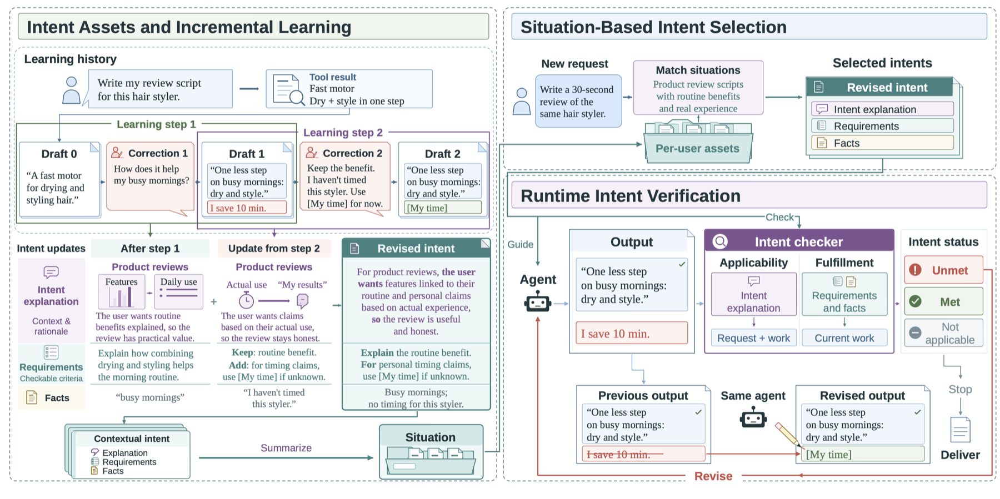
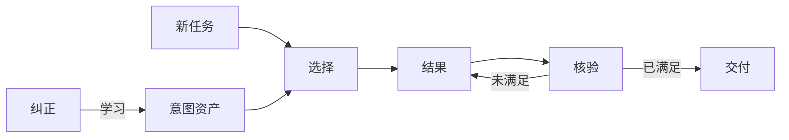

# LiveAsset

[English](README.md) · **简体中文**

**用户的任务需求需要在与Agent的多轮交互中逐渐明确。很多时候，用户能够用语言描述出Agent的交付结果哪里不对，却很难说清自己到底想要什么，直到最终结果让自己满意。LiveAsset 会把多轮纠正里逐步显现的期望累积成可复用的意图资产，模仿人的多轮交互来指导Agent的行为直到符合用户的预期。**

*纠正型交互不是少数情况：论文在对 [SWE-chat 编码对话](https://arxiv.org/abs/2604.20779)的分析里，331 条纠正或澄清消息中有 135 条（40.8%）只指出Agent的做法哪里不对，并没有明确说明想要的结果。*

[](https://arxiv.org/abs/2611.11560) [](https://www.python.org/downloads/) [](https://github.com/landian60/LiveAsset/releases)

*LiveAsset: Learning Intent Assets from Corrective Interactions for Agent Runtime Control*  
Guanming Liu 等 · arXiv:2611.11560 · 2026

### 示例：两步纠正

用户刚买了个吹干、造型二合一的美发器，想发一条 30 秒的使用分享，让 AI 帮着写稿。第一版写得像参数表——"A fast motor for drying and styling hair."（马达很快，能吹干也能造型）。用户没有给出需求文档，只发了两条纠正消息（就是下面这张图 3）。


| 轮次  | 用户的纠正                                                                                       | 修订后的结果                                                               |
| --- | ------------------------------------------------------------------------------------------- | ------------------------------------------------------------------ |
| 1   | "How does it help my busy mornings?"（意思是：脚本里该讲讲这东西对忙碌的早晨有什么用，并不是在提问）                      | "One less step on busy mornings: dry and style. I save 10 min."（早上少一步：吹干带造型，一次搞定；能省 10 分钟） |
| 2   | "Keep the benefit, but I haven't timed it. Don't invent my results. Use [My time] for now."（保留这点，但用户没有计过时，不能替用户编结果，先用 `[My time]` 占位） | "One less step on busy mornings: dry and style. I save [My time]."（保住早晨那条好处；把编造的用时换成占位符）                |


两句话里没有一条能直接抄成规则——第一句听着还像个问句，用户的意思其实是「把这点写进脚本里」。对照每轮纠正前后的结果，两条要求才显出来：把产品好处接到真实的早晨场景里，以及没亲测过的个人结果不能替用户编成事实。第一轮修订为了说明「早晨少一步」，智能体自己补了 "I save 10 min."（能省 10 分钟）——这个数字用户从没给过，第二轮纠正正是针对它。新增的要求没有覆盖掉第一条；这组要求连同适用情境，就是意图资产。

**后续任务**：用户又让它给同一款产品写一条 30 秒口播。草稿顺手又写了 "I save 10 min."，可用户根本没计过时 → 判 `unmet`，交付前被拦下 → 同一个智能体改成 "I save [My time]." → 判 `met`，交付。

把**每条纠正与它前后的结果放在一起学习** → 在下一个任务入口**选出适用情境** → 对当前结果**逐条核验要求**。

离线跑通同一条链路：[examples/README.md](examples/README.md) 里有对应三个阶段的可运行脚本，以及论文所用五个 benchmark 的案例。不需要 API key 或网络。

## 更新

- **2026-11-08** —— 技术报告上线 [arXiv](https://arxiv.org/abs/2611.11560)（v1）。
- **2026-11** —— **v0.1.0 首次公开源码发布**：核心库、可独立安装的 Codex 插件与 hooks、MCP server、离线示例，以及匿名化的路由用例。


## 目录

- [LiveAsset 是什么](#liveasset-是什么)
- [结果](#结果)
- [工作机制](#工作机制)
- [快速开始](#快速开始)
- [接入智能体](#接入智能体)
- [示例](#示例)
- [仓库结构](#仓库结构)
- [引用](#引用)
- [贡献](#贡献)
- [许可证](#许可证)


## LiveAsset 是什么

LLM 智能体在跨应用完成任务时，往往需要多轮纠正交互，输出才符合用户预期。用户常常能指出交付结果中的差异，却无法明确描述期望的结果——期望只能从原始结果与修订结果之间的变化中推断。LiveAsset 是一套**意图框架（intent harness）**：把这些纠正转换成可复用的**意图资产**，再用它控制之后的执行过程。

- **从纠正里学，而不只是从指令里学。** 每条纠正都会和智能体的原始结果、修订结果一起被解读，隐含的期望可以从「哪里变了」里还原出来。资产按增量更新，先前仍然适用的要求会保留。
- **存的是上下文，不只是事实。** 资产把意图组织进**情境（situations）**。每条意图包含*说明*（何时为何适用）、可逐条**核验的要求**，以及带原文引语的支撑**事实**。说明刻画适用性，要求与事实刻画判定标准。
- **交付之前先核验。** 任务入口先按情境匹配选出相关意图；回复交付前，检查器把每条要求和事实判为 `met`、`unmet` 或 `not_applicable`，并把未满足项交回同一个智能体，让它给出完整修订结果。

上面的例子来自报告图 3；[examples](examples/README.md) 用更小的资产和五个 benchmark 案例跑同样的三个阶段。与记忆检索、已存技能或基于规则的放行检查不同，这里学到的要求既绑定在一段被描述出来的情境上，又会在运行时针对当前结果被核验。

## 结果

下表数字**来自论文**（表 1，执行模型 GPT-6 Luna）。


| 方法            | [π-Bench](https://arxiv.org/abs/2605.14678) 满足度 | [PERMA](https://arxiv.org/abs/2603.23231) 满足度 | [Vita](https://arxiv.org/abs/2605.27141) 满足度  | [PAST](https://arxiv.org/abs/2608.04003) 总体 / 远迁移     | [SkillEvol](https://arxiv.org/abs/2605.24117) 总体 |
| ------------- | ----------- | --------- | --------- | ----------------- | ------------ |
| Raw history   | 0.801       | 0.881     | 0.789     | 0.933 / 0.910     | 0.857        |
| Skill         | 0.554       | 0.704     | 0.733     | 0.836 / 0.833     | 0.854        |
| Mem0          | 0.607       | 0.848     | 0.689     | 0.898 / 0.904     | 0.832        |
| TellOnce      | 0.738       | 0.882     | 0.728     | 0.749 / 0.729     | 0.806        |
| **LiveAsset** | **0.925**   | **0.954** | **0.898** | **0.956 / 0.945** | **0.861**    |


在双执行模型研究中，LiveAsset 在三个同任务重放 benchmark（π-Bench、PERMA、Vita）上的要求满足度最高，并在两个执行模型下都以远迁移（PAST-Bench）领先于可复用框架类基线。它并非处处第一：PERMA 的任务完成度仍由 Raw history 领先，GPT-6 Luna 下 SkillEvolBench T6 由 Skill 领先。DeepSeek V4.1-Flash 的结果、消融、多次运行稳定性和 token 开销见论文。

## 工作机制



*报告图 3（arXiv 最终版）。左：两步纠正逐步构建意图资产。右：任务入口按情境选择，运行时核验并引导同一个智能体修订。上方的小例子就是这张图里的产品评测交互。*




匹配器读的是情境描述和意图说明，不读要求与事实；选中之后，智能体才会收到对应意图的要求和历史事实。检查器针对当前结果与可见证据逐条判定，某个项目特有的存档数值不会自动套用到另一个项目。模型失败和未完成的核验会与一次成功的检查区分开来，`match` 也可能返回 `status="failed"`，而不是一个空选择。

**学习是独立且有开关的操作。** 本地适配器要求用户明确提出请求，才会抽取或更新资产；匹配新任务、读取工具结果、结束一次回复都不会触发学习。API、资产结构、事件处理和失败边界见[文档导航](docs/index.md)与[核心机制和宿主接入](docs/architecture.md)。

## 快速开始

需要 Python 3.11+，不需要凭据。在本目录执行：

```bash
python3 -m venv .venv
.venv/bin/python -m pip install .
.venv/bin/python examples/quickstart.py
```

这个[离线示例](examples/quickstart.py) 会载入[一份手工编写的资产](examples/report-asset.json)、选出情境，先检查一版错误草稿，再检查修订后的草稿，并打印注入的要求和两次检查结果。模型回复是**脚本化**的，因此无需登录、API key 或网络；它演示接口和修订流程。资产文件遵循 [asset.schema.json](schema/asset.schema.json)。

## 接入智能体


| 用途                       | 入口                                                                       |
| ------------------------ | ------------------------------------------------------------------------ |
| 接入自己的模型与执行循环             | [核心 API 与机制](docs/architecture.md)                                       |
| 在 Codex 中按用户轮次和新的工具证据做匹配 | [Codex 插件安装](integrations/codex-liveasset/README.md#local-setup)         |
| 从其他 harness 调用匹配与检查      | [MCP 接入](integrations/codex-liveasset/README.md#mcp-for-other-harnesses) |
| 查看自然的多轮测试输入              | [路由用例](integrations/codex-liveasset/cases/README.md)                     |
| 运行学习 / 选择 / 核验的离线示例      | [示例](examples/README.md)                                                 |


核心只要求调用方提供一个带 `async chat(messages)` 的模型对象；随包提供的插件和 MCP server 用 Codex CLI 完成模型调用。本地适配器把**任务 ID** 与**会话 ID** 分开：一次会话可能转到新任务，被显式续接的任务也可能在另一个会话里继续。执行、工具访问，以及是否展示或修订候选回复，仍由宿主决定。

## 示例

下面每个脚本都以**脚本化的模型回复**离线运行：不用登录、不用 API key、不联网。


| 脚本                                                                       | 阶段        | 你会看到                                            |
| ------------------------------------------------------------------------ | --------- | ----------------------------------------------- |
| `[examples/learn_from_correction.py](examples/learn_from_correction.py)` | **学习**    | 一句只指出问题的纠正生成一份意图资产，这份资产在下一个任务里拦下不合格草稿。          |
| `[examples/switch_situations.py](examples/switch_situations.py)`         | **选择**    | 同一份资产、三个请求：两次选中不同情境，无关请求不选中任何情境。                |
| `[examples/quickstart.py](examples/quickstart.py)`                       | **核验**    | 错误草稿被退回修订，修订后的草稿通过。                             |
| `[examples/benchmark-cases/](examples/benchmark-cases/README.md)`        | **跨任务选择** | 论文所用五个 benchmark 的五个学习案例，每个都带原始交互、学到的资产和六条后续请求。 |


```bash
PYTHONPATH=src python3 examples/learn_from_correction.py
PYTHONPATH=src python3 examples/switch_situations.py
PYTHONPATH=src python3 examples/quickstart.py
PYTHONPATH=src python3 examples/run_benchmark_cases.py
```

各脚本会打印什么见 [examples/README.md](examples/README.md)，案例文件见 [benchmark-cases/README.md](examples/benchmark-cases/README.md)。更长的多轮序列、工具事件和任务边界，见[路由用例](integrations/codex-liveasset/cases/README.md)及其离线回放命令。

## 仓库结构

```text
LiveAsset/
├── src/liveasset/                       核心：结构、学习、匹配、检查
│   ├── situated_intents.py              机制、校验、状态流转
│   └── prompts.py                       全部模型指令文本
├── integrations/codex-liveasset/        可独立安装的 Codex 插件 + MCP server
│   ├── scripts/                         服务、hooks、MCP、回放工具
│   ├── skills/liveasset/SKILL.md         插件技能定义
│   ├── cases/                           匿名化 / 合成的多轮用例
│   ├── vendor/liveasset/                生成的核心副本，请勿编辑
│   └── README.md                        安装、hooks、MCP、失败处理
├── assets/overview.png                  报告图 3（方法概述）
├── docs/
│   ├── index.md                         文档导航与阅读顺序
│   └── architecture.md                  机制、核心 API、边界
├── schema/asset.schema.json             意图资产的 JSON Schema
├── examples/                            可离线运行的示例
├── tests/                               核心单元测试
├── tools/sync_liveasset_vendor.py       同步 / 校验生成的核心副本
├── .github/workflows/tests.yml           CI：Linux 与 macOS 上的 Python 3.11/3.12
├── CITATION.cff                         GitHub「Cite this repository」元数据
├── README.md                            英文版说明
├── README.zh-CN.md                      本文件
├── CONTRIBUTING.md
└── LICENSE
```

修改 `src/` 下的核心后，运行 `python tools/sync_liveasset_vendor.py` 刷新插件里的生成副本。阅读顺序、本地检查与用例约定见 [docs/index.md](docs/index.md) 和 [CONTRIBUTING.md](CONTRIBUTING.md)。

## 引用

如果在研究中使用 LiveAsset，请引用技术报告。GitHub 的 **Cite this repository** 按钮读取 [CITATION.cff](CITATION.cff)。

```bibtex
@misc{liu2026liveasset,
  title         = {{LiveAsset}: Learning Intent Assets from Corrective Interactions for Agent Runtime Control},
  author        = {Liu, Guanming and Wang, Weihang and Zhang, Peng and Wu, Meng and Tu, Kainan and Liu, Jiahao and Zhang, Yu and Zhang, Liuxin and Wang, Qianying and Gu, Ning and Lu, Tun},
  year          = {2026},
  eprint        = {2611.11560},
  archivePrefix = {arXiv},
  primaryClass  = {cs.AI},
  url           = {https://arxiv.org/abs/2611.11560}
}
```


## 贡献

欢迎提 issue 和 pull request。开发流程、测试命令与用例约定见 [docs/index.md](docs/index.md) 和 [CONTRIBUTING.md](CONTRIBUTING.md)。请勿把凭据、个人资产或原始用户对话写进仓库用例。

## 许可证

本包中的 LiveAsset 源码、文档与示例采用 [MIT 许可证](LICENSE)。第三方依赖沿用各自许可证。